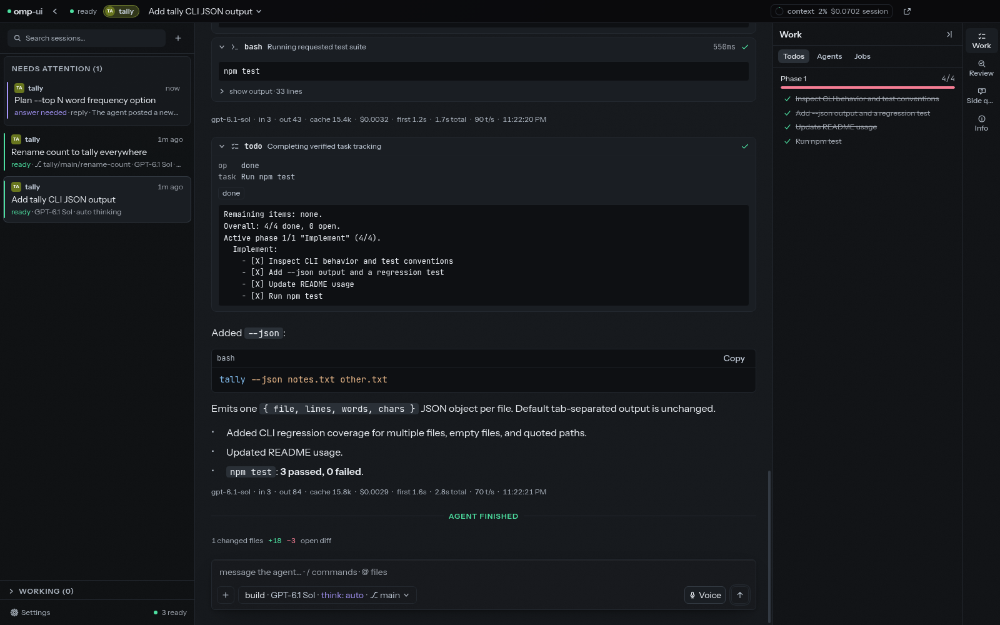
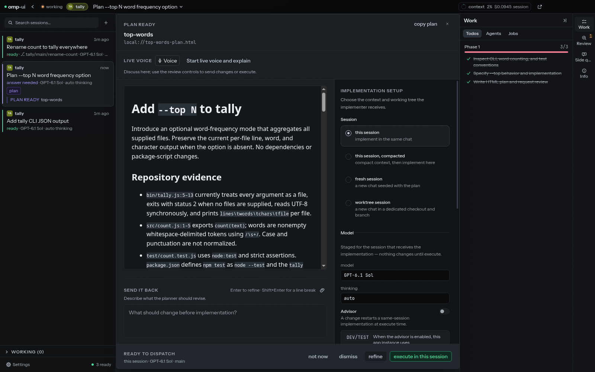
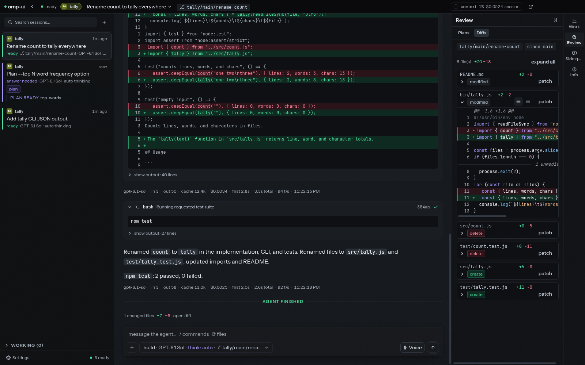
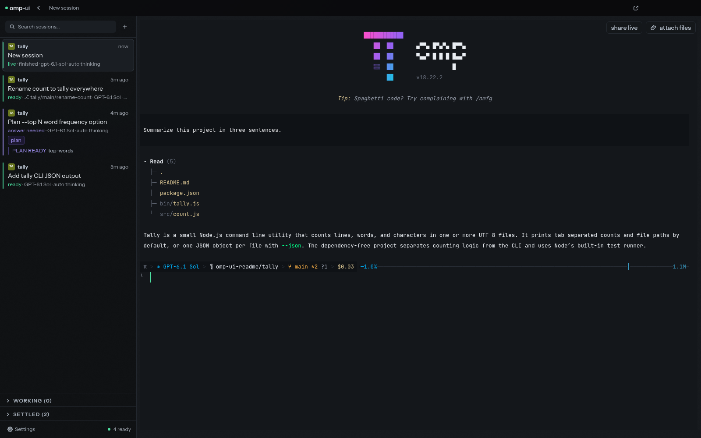
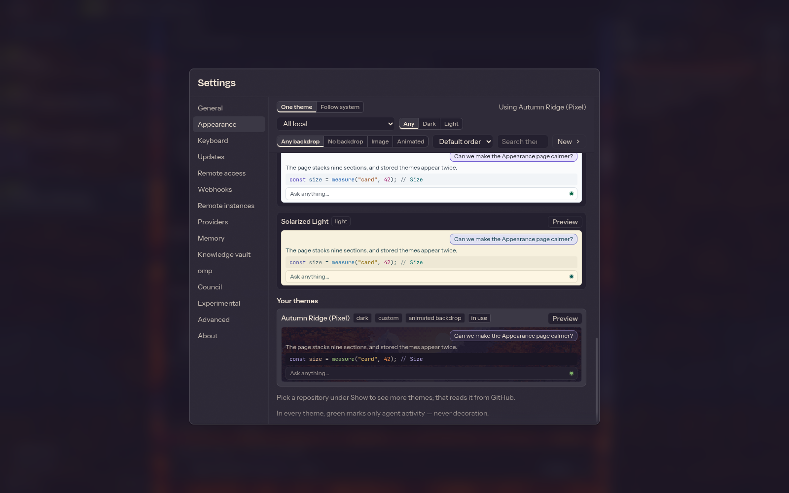
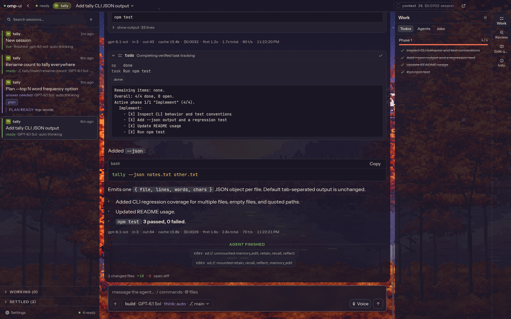
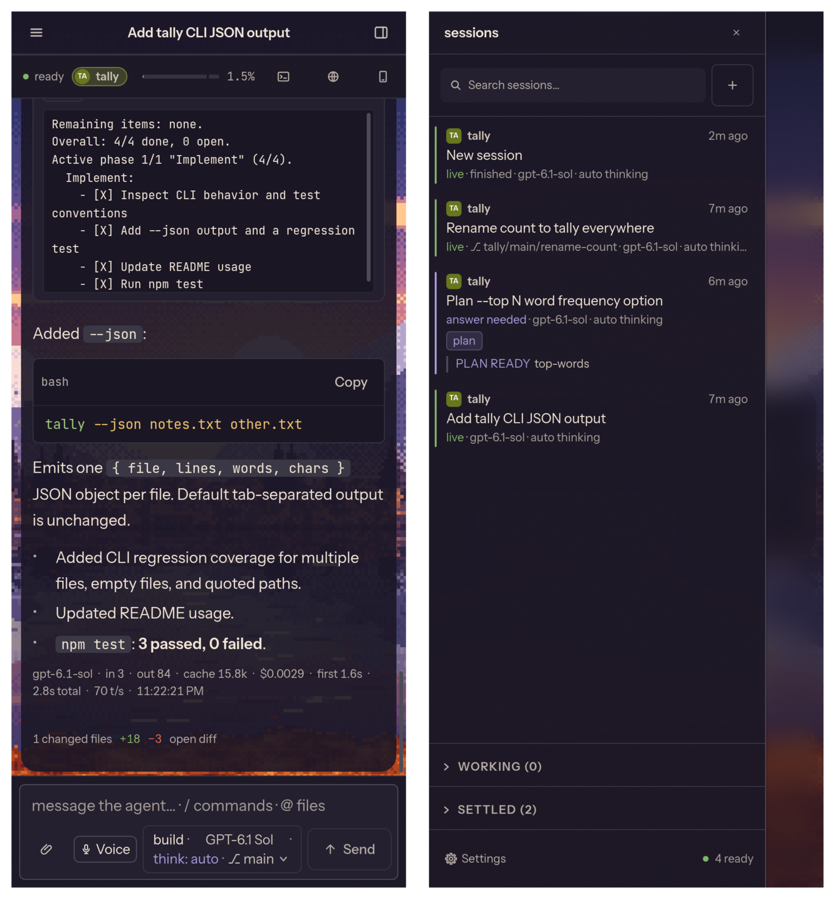

# omp-ui

omp-ui is a desktop app for [Oh My Pi](https://github.com/can1357/oh-my-pi), the `omp` coding agent. It runs omp sessions in tabs and lists them all in one sidebar, across your projects and across machines. A native tab renders the session as a transcript with a composer and an inspector rail for todos, subagents, plans, and diffs. A terminal tab runs omp's own TUI with its usual keybindings.

omp-ui runs on Linux and macOS, with a Windows preview. It can also serve itself to a browser or the Android client, so you can check on an agent from your phone.



## What it does

- **Sessions in one list.** Register a project once, then start sessions from the project quick-open (`Mod+Shift+N`). The sidebar shows every session omp-ui started with its project, model, branch, and state, and moves it to **Working** while a turn runs. Hiding a tab leaves the agent running. Settle a session when you are done with it; you can resume it later.
- **Native transcript.** Native tabs render markdown, thinking, tool calls and their results, subagent activity, and a usage receipt for each response with tokens, cost, and time to first token. The composer takes image and file attachments, `@` file references, and slash commands. While a turn runs you can steer it, queue a follow-up, or interrupt it.
- **Plan mode and review.** In Plan mode omp explores read-only. When it proposes a plan, the review opens in that session. Execute the plan in the same session, a fresh session, or a new worktree session, or send it back with notes.
- **Worktree sessions.** A worktree session runs in its own git checkout and branch, so several agents can work on one project without touching your working tree. The Diffs pane shows the branch's changes, and merge-back lands them on the base branch.
- **Inspector rail.** Each native tab has a rail with todos, subagents (open one to read its transcript), background jobs, plans, diffs, `/btw` side questions, and session details.
- **Terminal tabs.** Any session can run in omp's TUI instead. Switching between native and terminal mode resumes the same session.
- **Remote access and the fleet.** Turn on [remote access](docs/remote-access.md) to use the app from a browser or the Android client. Join other omp-ui apps, or [headless `omp-ui-lite` members](docs/remote-access.md#join-a-headless-member), as [remote instances](docs/remote-instances.md). Their sessions appear in your sidebar, and you or your agents can dispatch work to them.
- **Themes.** Twelve built-in themes, a theme editor, VS Code theme import, and theme repositories. A custom theme can carry an animated backdrop, and themes apply to the browser and phone views too.
- **Managed omp.** omp-ui can install and update its own copy of `omp` and pass your provider keys to every session it starts. The app installs its own updates from in-app update cards.

The [user guide](docs/user-guide.md) covers the rest, including the shared browser pane, the Android emulator pane, goal mode, and Obsidian vault notes.

## Screenshots

<table>
  <tr>
    <td width="50%"></td>
    <td width="50%"></td>
  </tr>
  <tr>
    <td><strong>Plan review.</strong> A proposed plan opens in its session. Execute it here, in a fresh session, or in a worktree.</td>
    <td><strong>Diffs.</strong> A worktree session's branch changes, shown in the inspector rail.</td>
  </tr>
  <tr>
    <td></td>
    <td></td>
  </tr>
  <tr>
    <td><strong>Terminal tab.</strong> omp's own TUI in an embedded terminal.</td>
    <td><strong>Appearance.</strong> Each theme card shows a live sample of the app in that theme.</td>
  </tr>
</table>

### Custom themes on desktop and phone

Autumn Ridge is a custom theme with a pixel-art backdrop. The phone view is the same app opened in a phone-sized browser through remote access.



<p align="center">
  
</p>

## Install

### Linux

Install the supported Linux AppImage:

```bash
curl -fsSL https://raw.githubusercontent.com/LankfordAI/omp-ui/main/packaging/install.sh | bash
```

### macOS

Download the signed and notarized Apple Silicon (`arm64`) DMG from the
[latest release](https://github.com/LankfordAI/omp-ui/releases/latest). Intel
Macs are not supported. Open the DMG and drag **omp-ui** to **Applications**.

### Windows preview

Download the unsigned x64 `setup.exe` from the
[latest release](https://github.com/LankfordAI/omp-ui/releases/latest) and run
it. If SmartScreen warns about the unknown publisher, select **More info**,
then **Run anyway**. Do not disable SmartScreen or Defender.

### Android

Build the Kotlin/WebView APK from [`android/`](android/) using the
[Android development instructions](docs/development.md#android-app), then
connect it to your host's [remote access](docs/remote-access.md#android-app-client).
Requires Android 10 or newer and an updated System WebView. Build the host from
this checkout too; Android recovery lives in its shared renderer. The APK is
not yet published in the desktop release assets.

See [Getting started](docs/getting-started.md) for checksums, platform details,
first launch, and uninstall instructions.

## Documentation

Start at the [documentation home](docs/README.md), or go straight to a
guide:

- [Getting started](docs/getting-started.md)
- [User guide](docs/user-guide.md)
- [Settings](docs/settings.md)
- [Remote access](docs/remote-access.md)
- [Troubleshooting](docs/troubleshooting.md)
- [Architecture](docs/architecture.md)
- [Releases](docs/releases.md)

## Development

Development requires Node.js 22 or newer.

```bash
npm install
npm run dev
```

See the [development guide](docs/development.md) for the repository layout,
commands, testing, and contribution workflow.

## License

omp-ui is available under the [MIT License](LICENSE).
